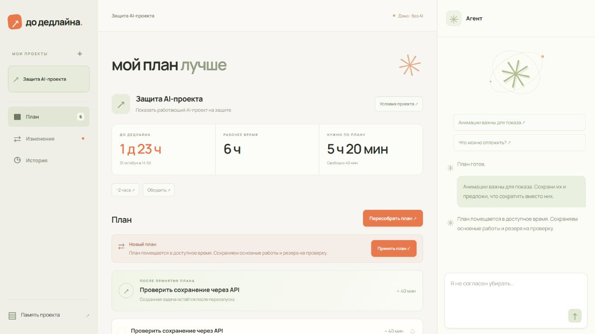

# Мой план лучше

AI-агент для проектов, которые нужно успеть закончить. Предлагает план, объясняет
приоритеты и компромиссы, учитывает возражения и пересчитывает работу при изменении условий.
В интерфейсе — **«мой план лучше»**.

**Сценарий:** цель и ограничения → предложение → проверка времени и зависимостей →
спор с агентом → сравнение вариантов → принятие → следующий шаг.



- Планы с причинами, зависимостями, оценками времени и критериями готовности.
- Явный архив выполненных и отложенных задач, сохранение истории без лимита в 30 задач.
- Закрепление задач, раздельный учёт бюджета, потерь и фактического времени.
- Безопасный повтор пересчёта после сбоя без повторного списания времени.
- Переименование проектов и удаление с подтверждением, включая связанные данные.
- Серверная проверка выполнимости; до трёх попыток исправить предложение модели.
- Постоянная память, точный подсчёт токенов, автоматическое сжатие и восстановление версий.
- Чат с немедленным отображением отправленного сообщения и повтором при ошибке.
- Черновики проекта и сообщений на 24 часа; отдельный текст обсуждения для каждого проекта.
- Интерфейс для компьютера и телефона; ошибки формы отображаются на месте.
- Отдельный демонстрационный режим без AI и ключей.
- Защита входа, блокировка параллельных генераций в базе и ограничение размера HTTP-запросов.

[Демо интерфейса — приватный просмотр](https://taskmaster-matrix-design-razun.tretakovonegov.chatgpt.site) ·
[Архитектура](docs/architecture.md) · [Планирование и API](docs/planning-api.md) ·
[Память](docs/memory-api.md) · [Миграции](docs/database.md) · [Для портфолио](docs/portfolio.md)

## Быстрый запуск

Python 3.12+ и Node.js для тестов интерфейса. Приложению Node.js не требуется.

```powershell
python -m venv .venv
.\.venv\Scripts\python.exe -m pip install -r requirements-dev.txt
Copy-Item .env.example .env
# Заполните YANDEX_API_KEY и YANDEX_FOLDER_ID в .env.
.\scripts\run-local.ps1
```

Откройте `http://127.0.0.1:8000`. По умолчанию скрипт использует SQLite
в `.local/deadline.db`. Изменения схемы применяются через Alembic при запуске.
`/docs` содержит схемы API; `?demo=1` включает пример без запросов к модели.

Для PostgreSQL создайте базу `taskmaster`, задайте `DATABASE_URL` в `.env` и запустите:

```powershell
.\scripts\run-local.ps1 -UsePostgres
```

Инструкция получения ключа — [Yandex AI Studio](https://aistudio.yandex.ru/ru/docs/ai-studio/operations/get-api-key).
Сервисному аккаунту нужна роль `ai.languageModels.user`, ключу — область
`yc.ai.languageModels.execute`. Ключ хранится на сервере; `.env` исключён из Git и Docker.

## Docker

Перед запуском Docker задайте в `.env` `APP_PASSWORD` — случайный пароль не короче 16 символов. Вход в браузере: пользователь `owner` (либо `APP_USERNAME`) и этот пароль.

```bash
docker compose up --build
```

Откройте `http://127.0.0.1:8000`. Compose запускает PostgreSQL 16 с постоянным томом,
проверяет готовность базы и запускает приложение с миграциями. База доступна внутри
сети Compose и не занимает порт установленного локально PostgreSQL.

## Настройки контекста

```dotenv
CONTEXT_BUDGET_TOKENS=16000
RESPONSE_RESERVE_TOKENS=2000
CONTEXT_COMPRESSION_THRESHOLD=0.75
```

Перед каждым обращением агента проекта токенизатор считает полный ввод. При достижении
75% бюджета вместе с резервом на ответ агент сжимает накопленный диалог. Исходные
сообщения и версии до/после сохраняются. Свежий запрос, факты проекта и данные плана
остаются в контексте. Если даже сжатый запрос не помещается, сервер отклоняет его
без отправки на генерацию. Бюджет — настройка приложения, а не бесплатная квота провайдера.
Подробнее — [управление памятью](docs/memory-api.md).

## Проверки

```bash
python -m ruff check
python -m mypy src/
python -m pytest -q
node --test frontend/tests/*.test.mjs
python -m alembic check
```

`requirements-dev.txt` включает инструменты разработки; `requirements.txt` — зависимости
приложения. Тесты используют подменённые ответы модели, внешние HTTP-запросы заблокированы.
Для проверки на PostgreSQL задайте `TEST_DATABASE_URL` (тот же формат, что у `DATABASE_URL`)
и повторите pytest. Каждый тест получает отдельную временную схему, которая затем удаляется.
CI выполняет проверки кода, обе базы, миграции и тесты интерфейса.

## Устройство проекта

```text
src/                 FastAPI, агент, проверка планов, память и модели данных
frontend/dist/       интерфейс без сборки, отдельный demo.js
frontend/tests/      тесты черновиков, прогресса и состояния интерфейса
migrations/          версионированные изменения схемы Alembic
scripts/             локальный запуск
tests/               сценарии API, состояния, контекста и миграций
docs/                архитектура, API, запуск и демонстрационный сценарий
```

Стек: Python, FastAPI, Pydantic, SQLAlchemy async, Alembic, PostgreSQL/SQLite,
YandexGPT, HTML/CSS/JavaScript. Старые экран, API и AI-цикл матрицы удалены. Исторические данные сохранены;
[выгрузка прежних задач](docs/legacy.md) доступна отдельно.

Приложение рассчитано на одного владельца. При пустом `APP_PASSWORD` разрешён только доступ
с localhost; запросы чужих сайтов блокируются. Для внешнего доступа задайте сильный
`APP_PASSWORD` (от 16 символов), `APP_USERNAME` и настройте HTTPS. Приложение использует
защищённые сессии, ограничивает неудачные попытки входа и блокирует встраивание в чужие страницы. Docker остаётся привязан к 127.0.0.1;
разрешение HTTP в Compose предназначено для этого локального режима.
Многопользовательский режим с отдельными владельцами проектов пока не реализован. Проверка времени детерминирована;
смысловая полнота требований и качество оценок модели требуют внимания пользователя.
[Сценарий показа и границы](docs/demo.md).


Для обычного запуска без PowerShell-скрипта: `python main.py serve`.
Разработка с автоматическим перезапуском: `python main.py serve --reload`.
Контейнер запускается от непривилегированного пользователя и содержит только
сервер, миграции и файлы интерфейса. Версии прямых зависимостей зафиксированы в requirements.txt.
