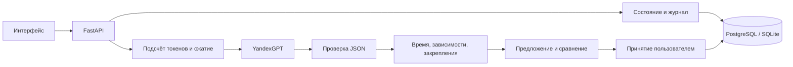

# Архитектура

## Почему агенту можно возражать

Канонические факты проекта хранятся отдельно от текста диалога. Сгенерированный план
сначала становится предложением. Сервер считает время, проверяет зависимости и защищённые
задачи. Пользователь видит различия и причины, затем явно принимает вариант.
Невалидное предложение не может стать принятым планом.

## Память и контекст

Полный журнал сообщений не удаляется. Рабочий контекст состоит из системной инструкции,
актуальных фактов, последней сводки и сообщений после её границы. Для планирования
добавляются схема ответа, текущий и последний предложенный планы, прогресс и события.
Перед каждым запросом и повторной попыткой проверяется точный размер полного ввода.

Автоматическое сжатие готовит две версии в памяти процесса. Они записываются вместе
с ответом одной транзакцией и одним увеличением revision. Ошибка модели или конкурирующая
правка оставляет прежний контекст и журнал неизменными. Канонические факты и свежий
запрос не сжимаются. Команда `/compress` остаётся доступной отдельно.

## Надёжность

- UUID запроса делает успешный повтор идемпотентным.
- Запись блокировки в БД не допускает параллельные обращения к модели в одном проекте, включая разные процессы сервера.
- Сравнение revision при записи предотвращает потерю параллельных правок.
- Сетевые вызовы выполняются вне транзакций базы данных.
- Миграции запускаются транзакционно; PostgreSQL использует advisory lock при старте.
- PostgreSQL и SQLite проверяются одним набором тестов; внешняя сеть в тестах отключена.
- UI показывает отправленное сообщение сразу и согласует его с серверным журналом по UUID.

## Границы

Ссылки задач на обязательные требования проверяются по номерам, без независимой
семантической оценки. Сервер не доказывает реалистичность оценок времени, созданных моделью.
Доступ защищён режимом localhost и HTTP Basic для одного владельца при настроенном пароле. Раздельные аккаунты пользователей, командная работа и самостоятельное выполнение задач пока не реализованы.
Статическое демо использует сценарий в браузере; настоящий агент работает с API и БД.

## Защита входа и браузера

Без `APP_PASSWORD` доступны только запросы от loopback-клиента с локальным Host. Проверки Origin и Sec-Fetch-Site отклоняют чужие сайты, в том числе на чтение API. При заданном пароле используется HTTP Basic: пользователь `APP_USERNAME` (по умолчанию owner), пароль от 16 символов. Для внешнего клиента по умолчанию требуется HTTPS. Исключение `/health` сообщает только состояние процесса. Ответы запрещают iframe-встраивание; данные API не кешируются браузером.

Для публичного размещения используйте HTTPS-прокси с корректно настроенным доверием к forwarded-заголовкам. `APP_ALLOW_HTTP=true` допустим только в доверенном локальном режиме; Compose использует его из-за сетевого шлюза Docker и публикует порт исключительно на 127.0.0.1. Пустой пароль не разрешает доступ со шлюза Docker.

Неудачные входы ограничены: 10 на адрес клиента и 100 суммарно за минуту на процесс
сервера. Ответ `429` содержит Retry-After; по окончании окна вход снова доступен.
Счётчики ограничены по памяти. Для нескольких процессов или экземпляров общий лимит
на уровне развёртывания задаётся на HTTPS-прокси; встроенные счётчики не разделяются между ними
и очищаются при перезапуске. Доверяйте forwarded-заголовкам только от своего прокси.

Старый `/api/process` отвечает 410 без вызовов модели; прежний AI-цикл удалён.
Старые HTTP-операции матрицы удалены; историческая таблица доступна только через выгрузку JSON в CLI.

Тела изменяющих HTTP-запросов ограничены 1 МиБ (`MAX_REQUEST_BYTES`). Проверяется
фактически прочитанный объём, включая потоковые запросы без Content-Length.
Контейнер запускается без прав root. Обычный запуск сервера не включает reload;
режим наблюдения за исходниками включается только флагом --reload.
