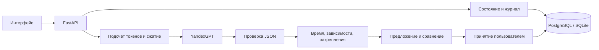

# Архитектура

## Почему агенту можно возражать

Канонические факты проекта хранятся отдельно от текста диалога. Сгенерированный план
сначала становится предложением. Сервер считает время, проверяет зависимости и защищённые
задачи. Пользователь видит различия и причины, затем явно принимает вариант.
Невалидное предложение не может стать принятым планом.

## Память и контекст

Полный журнал сообщений не удаляется. Рабочий контекст состоит из системной инструкции,
актуальных фактов, последней сводки и сообщений после её границы. Для планирования
добавляются схема ответа, текущий и последний предложенный планы, прогресс и события.
Перед каждым запросом и повторной попыткой проверяется точный размер полного ввода.

Автоматическое сжатие готовит две версии в памяти процесса. Они записываются вместе
с ответом одной транзакцией и одним увеличением revision. Ошибка модели или конкурирующая
правка оставляет прежний контекст и журнал неизменными. Канонические факты и свежий
запрос не сжимаются. Команда `/compress` остаётся доступной отдельно.

## Надёжность

- UUID запроса делает успешный повтор идемпотентным.
- Сравнение revision при записи предотвращает потерю параллельных правок.
- Сетевые вызовы выполняются вне транзакций базы данных.
- Миграции запускаются транзакционно; PostgreSQL использует advisory lock при старте.
- PostgreSQL и SQLite проверяются одним набором тестов; внешняя сеть в тестах отключена.
- UI показывает отправленное сообщение сразу и согласует его с серверным журналом по UUID.

## Границы

Ссылки задач на обязательные требования проверяются по номерам, без независимой
семантической оценки. Сервер не доказывает реалистичность оценок времени, созданных моделью.
Авторизация, командная работа и самостоятельное выполнение задач пока не реализованы.
Статическое демо использует сценарий в браузере; настоящий агент работает с API и БД.
